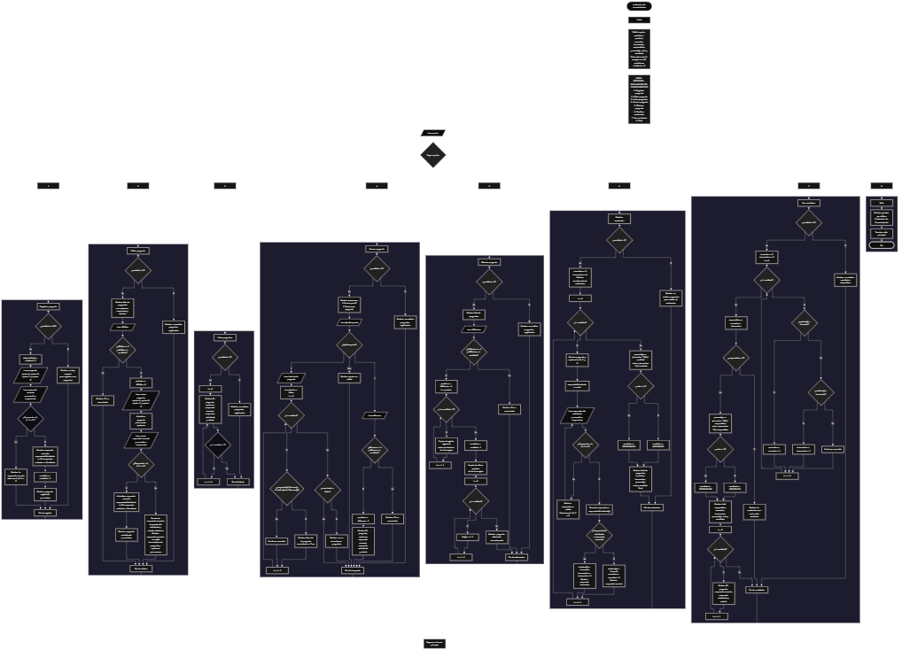

Este proyecto, llamado <b>evaluación de conocimientos</b>, fue desarrollado en <b>visual basic .net</b> como un ejercicio práctico para fortalecer la lógica de programación mediante la creación de un sistema de preguntas y evaluaciones desde la consola. El programa cuenta con un menú principal de ocho opciones que permite <b>registrar, editar, eliminar, buscar y listar preguntas, realizar evaluaciones y consultar resultados</b>. Cada pregunta almacena información como el enunciado, cuatro opciones de respuesta, la respuesta correcta, la respuesta seleccionada por el estudiante y su estado, utilizando nueve arreglos paralelos con una capacidad máxima de <b>20 preguntas durante la ejecución</b>. Durante su desarrollo se aplicaron conceptos fundamentales de programación, como variables, arreglos, estructuras condicionales, ciclos repetitivos y estructuras de selección, además de procesos para buscar, modificar, eliminar y reorganizar registros. También se implementaron cálculos para determinar las respuestas correctas e incorrectas, el porcentaje obtenido, la nota final y el resultado de la evaluación. Este proyecto permite poner en práctica los conocimientos adquiridos en visual basic .net y sirve como base para desarrollar sistemas de evaluación más avanzados.

<h2 align="center">⚙️ Funcionamiento del menú principal</h2>

### ➕ Registrar pregunta

La opción <b>1) registrar pregunta</b> permite almacenar una nueva pregunta en el sistema de evaluación. Antes de realizar el registro, el programa comprueba que la cantidad de preguntas almacenadas sea menor que la capacidad máxima de los arreglos mediante la condición <b>cantidad &gt;= ids.Length</b>. Si se alcanza el límite de <b>20 preguntas</b>, muestra el mensaje <b>"no hay espacio para registrar más preguntas."</b>. Si existe espacio disponible, asigna un identificador utilizando <b>cantidad + 1</b> y solicita el enunciado, las cuatro opciones de respuesta y la respuesta correcta. Después, convierte la respuesta introducida a mayúsculas mediante <b>ToUpper()</b> y comprueba que corresponda a las letras <b>A, B, C o D</b>. Si la respuesta es válida, almacena los datos en sus respectivos arreglos, inicializa <b>respuestasEstudiante</b> con el valor <b>"Sin responder"</b> y establece el estado como <b>"Pendiente"</b>. Posteriormente, incrementa la variable <b>cantidad</b> en uno y muestra los datos de la pregunta registrada. Si la respuesta correcta no corresponde a ninguna de las cuatro opciones permitidas, presenta el mensaje <b>"la respuesta correcta debe ser A, B, C o D."</b> y no incrementa la cantidad de preguntas registradas.

### ✏️ Editar pregunta

La opción <b>2) editar pregunta</b> permite modificar la información de una pregunta registrada. Primero, el programa comprueba si existen preguntas almacenadas mediante la variable <b>cantidad</b>. Si no hay registros, muestra el mensaje <b>"no existen preguntas registradas."</b>. En caso contrario, utiliza un ciclo <b>For</b> para mostrar todas las preguntas con sus opciones, respuestas y estados. Después, solicita el ID de la pregunta que se desea editar y comprueba que esté dentro del rango permitido mediante la condición <b>idEditar &gt;= 1 AndAlso idEditar &lt;= cantidad</b>. Si el identificador es válido, calcula su posición utilizando <b>idEditar - 1</b> y solicita el nuevo enunciado y las cuatro opciones de respuesta. A continuación, solicita la nueva respuesta correcta y la convierte a mayúsculas mediante <b>ToUpper()</b>. Si corresponde a <b>A, B, C o D</b>, actualiza la respuesta correcta, reinicia la respuesta del estudiante con <b>"Sin responder"</b> y establece nuevamente el estado como <b>"Pendiente"</b>. Finalmente, muestra los datos actualizados de la pregunta. Si la respuesta introducida no es válida, presenta el mensaje <b>"la respuesta correcta debe ser A, B, C o D."</b>. Es importante destacar que el enunciado y las cuatro opciones se modifican antes de comprobar la nueva respuesta correcta, por lo que esos cambios permanecen aunque la respuesta introducida sea inválida. Si el ID no corresponde a una pregunta registrada, muestra el mensaje <b>"ID no encontrada."</b>.

### 📋 Listar preguntas

La opción <b>3) listar preguntas</b> permite visualizar todas las preguntas registradas actualmente en el sistema. Antes de mostrar la información, el programa comprueba si la variable <b>cantidad</b> es igual a cero. Si no existen preguntas, presenta el mensaje <b>"no existen preguntas registradas."</b>. Si hay registros disponibles, utiliza un ciclo <b>For</b> para recorrer los arreglos desde la primera posición hasta la cantidad total de preguntas almacenadas. Durante el recorrido, muestra el identificador, el enunciado, las cuatro opciones de respuesta, la respuesta correcta, la respuesta del estudiante y el estado de cada pregunta. Esta función facilita consultar los registros existentes y conocer la situación actual de cada pregunta dentro del sistema de evaluación.

### 🔎 Buscar pregunta

La opción <b>4) buscar pregunta</b> permite localizar una pregunta registrada mediante dos métodos de búsqueda. Primero, el programa comprueba si existen preguntas almacenadas. Si no hay registros, muestra el mensaje <b>"no existen preguntas registradas."</b>. En caso contrario, presenta un submenú con las opciones <b>1) buscar por ID</b> y <b>2) buscar por pregunta</b>. Cuando se selecciona la primera opción, solicita el identificador y comprueba que esté dentro del rango de preguntas registradas. Si el ID es válido, obtiene la posición mediante <b>idBuscar - 1</b> y muestra toda la información correspondiente. Cuando se selecciona la segunda opción, solicita un fragmento del enunciado y utiliza la variable lógica <b>encontrado</b>, inicializada en <b>False</b>, para controlar los resultados. Después, recorre el arreglo <b>preguntas</b> y compara los textos mediante <b>ToLower().Contains()</b>, permitiendo localizar coincidencias parciales sin distinguir entre mayúsculas y minúsculas. Cuando encuentra una coincidencia, muestra la información de la pregunta y cambia la variable <b>encontrado</b> a <b>True</b>. Si finaliza el recorrido sin encontrar coincidencias, presenta el mensaje <b>"no se encontraron preguntas."</b>. Si el usuario introduce una opción diferente de las disponibles en el submenú, muestra el mensaje <b>"opción no válida."</b>.

### 🗑️ Eliminar pregunta

La opción <b>5) eliminar pregunta</b> permite eliminar una pregunta registrada mediante su identificador. Antes de comenzar, el programa comprueba si existen preguntas almacenadas. Si no hay registros, muestra el mensaje <b>"no existen preguntas registradas."</b>. Si hay preguntas disponibles, utiliza un ciclo <b>For</b> para mostrar sus datos y solicita el ID de la pregunta que se desea eliminar. Después, comprueba que el identificador esté dentro del rango válido. Si la pregunta existe, obtiene su posición utilizando <b>idEliminar - 1</b> y comienza el proceso de reorganización. Para mantener los registros ordenados, utiliza un ciclo <b>For</b> que desplaza una posición hacia atrás los datos de los registros posteriores en los nueve arreglos: <b>ids, preguntas, opcionA, opcionB, opcionC, opcionD, respuestasCorrectas, respuestasEstudiante y estados</b>. Posteriormente, disminuye la variable <b>cantidad</b> en uno y limpia la última posición ocupada de todos los arreglos. Finalmente, utiliza otro ciclo <b>For</b> para renumerar los identificadores desde uno hasta la cantidad actual de preguntas registradas y muestra el mensaje <b>"pregunta eliminada correctamente."</b>. Si el ID introducido no corresponde a una pregunta registrada, presenta el mensaje <b>"ID no encontrada."</b>.

### 📝 Realizar evaluación

La opción <b>6) realizar evaluación</b> permite responder las preguntas registradas y obtener una calificación final. Primero, el programa comprueba si existen preguntas disponibles. Si no hay registros, muestra el mensaje <b>"no existen preguntas para realizar la evaluación."</b>. Si existen preguntas, inicializa los contadores <b>correctas</b> e <b>incorrectas</b> en cero y presenta el encabezado de la evaluación. Después, utiliza un ciclo <b>For</b> para recorrer todas las preguntas registradas y mostrar el enunciado junto con sus cuatro opciones de respuesta. Para cada pregunta, solicita una respuesta al estudiante y utiliza un ciclo <b>Do Loop While</b> para comprobar que la selección corresponda a las letras <b>A, B, C o D</b>. Si la respuesta no es válida, presenta el mensaje <b>"respuesta no válida. seleccione A, B, C o D."</b> y vuelve a solicitarla hasta recibir una opción permitida. Una vez validada, almacena la respuesta en el arreglo <b>respuestasEstudiante</b> y la compara con el contenido de <b>respuestasCorrectas</b>. Si ambas respuestas coinciden, establece el estado como <b>"Correcta"</b>, incrementa el contador <b>correctas</b> y muestra el mensaje <b>"respuesta correcta."</b>. De lo contrario, establece el estado como <b>"Incorrecta"</b>, incrementa el contador <b>incorrectas</b> y muestra el mensaje <b>"respuesta incorrecta."</b>. Al finalizar todas las preguntas, calcula el porcentaje mediante la fórmula <b>(correctas * 100) / cantidad</b> y la nota mediante <b>(correctas * 5) / cantidad</b>. Finalmente, comprueba si la nota es mayor o igual a <b>3</b> para determinar si el estudiante está <b>"APROBADO"</b> o <b>"REPROBADO"</b> y presenta el resumen con el total de preguntas, respuestas correctas, incorrectas, porcentaje, nota y resultado final.

### 📊 Ver resultados

La opción <b>7) ver resultados</b> permite consultar las estadísticas de la evaluación realizada y visualizar el detalle de las respuestas almacenadas. Primero, el programa comprueba si existen preguntas registradas. Si la cantidad es igual a cero, presenta el mensaje <b>"no existen resultados disponibles."</b>. En caso contrario, inicializa los contadores <b>correctas</b> e <b>incorrectas</b> en cero y utiliza un ciclo <b>For</b> para recorrer el arreglo <b>estados</b>. Durante el recorrido, comprueba si cada pregunta tiene el estado <b>"Correcta"</b> o <b>"Incorrecta"</b> y aumenta el contador correspondiente. Después, calcula la cantidad de preguntas respondidas mediante <b>correctas + incorrectas</b>. Si el resultado es igual a cero, muestra el mensaje <b>"la evaluación aún no ha sido realizada."</b>. Si existen respuestas registradas, calcula el porcentaje y la nota utilizando únicamente la cantidad de preguntas respondidas. Posteriormente, determina si el resultado es <b>"APROBADO"</b> o <b>"REPROBADO"</b> según la nota obtenida, y muestra el total de preguntas respondidas, correctas, incorrectas, porcentaje, nota y resultado. Finalmente, utiliza otro ciclo <b>For</b> para mostrar el identificador, enunciado, respuesta correcta, respuesta del estudiante y estado de cada pregunta. Esta opción permite consultar los resultados almacenados sin volver a realizar la evaluación.

### 🚪 Salir del menú principal

La opción <b>8) salir</b> está destinada a finalizar la ejecución del programa y muestra el mensaje <b>"gracias por utilizar evaluación de conocimientos."</b>. El menú principal se encuentra dentro de una estructura repetitiva <b>Do Loop While</b>, que mantiene el programa en funcionamiento mientras la opción seleccionada sea diferente de <b>8</b>. Cuando el usuario selecciona esta opción, el programa ejecuta el mensaje de despedida y finaliza el ciclo mediante la condición <b>opcion &lt;&gt; 8</b>. De esta manera, el usuario puede realizar las diferentes operaciones de administración y evaluación antes de terminar la ejecución.

<h2 align="center">🧠 Temas aplicados en el proyecto</h2>

### 📦 Variables

En este proyecto se utilizan variables para controlar las opciones del menú, administrar la cantidad de preguntas registradas, identificar las posiciones de los arreglos, almacenar las respuestas introducidas por el usuario, comprobar los resultados de las búsquedas y realizar los cálculos de la evaluación. También se utilizan contadores para registrar las respuestas correctas e incorrectas y variables auxiliares para determinar el porcentaje, la nota y el resultado final.

🔢 **Opcion:** Almacena la opción seleccionada por el usuario en el menú principal.

📊 **Cantidad:** Controla el número de preguntas registradas y permite comprobar la capacidad disponible de los arreglos.

🔄 **I:** Funciona como contador en los ciclos `For` y permite recorrer las preguntas almacenadas.

🔎 **IdEditar:** Almacena el identificador de la pregunta que se desea modificar.

🗑️ **IdEliminar:** Almacena el identificador de la pregunta que se desea eliminar.

📍 **Posicion:** Determina el índice correspondiente a una pregunta mediante la resta de uno al identificador seleccionado.

🔍 **TipoBusqueda:** Almacena el método de búsqueda seleccionado por el usuario.

📝 **PreguntaBuscar:** Almacena el texto introducido para localizar una pregunta.

✅ **Encontrado:** Variable lógica que indica si se encontró una pregunta durante la búsqueda.

✏️ **Respuesta y NuevaRespuesta:** Almacenan las respuestas correctas introducidas durante el registro y la edición de preguntas.

📝 **RespuestaEstudiante:** Almacena temporalmente la respuesta introducida por el estudiante durante la evaluación.

📊 **Correctas:** Cuenta la cantidad de respuestas correctas obtenidas durante la evaluación o consulta de resultados.

❌ **Incorrectas:** Cuenta la cantidad de respuestas incorrectas obtenidas durante la evaluación o consulta de resultados.

📈 **Respondidas:** Almacena el total de preguntas que ya fueron contestadas durante la evaluación.

🧮 **Porcentaje:** Almacena el porcentaje de respuestas correctas obtenido por el estudiante.

🎯 **Nota:** Almacena la calificación calculada sobre una escala de cinco puntos.

🏆 **Resultado:** Almacena el estado final de la evaluación, que puede ser `APROBADO` o `REPROBADO`.

### 🗃️ Arreglos

En este proyecto se utilizan nueve arreglos paralelos para almacenar la información de las preguntas y los resultados de las evaluaciones. Cada arreglo tiene una capacidad de <b>20 posiciones</b> y utiliza el mismo índice para representar los datos correspondientes a una misma pregunta. Por ejemplo, la información de una pregunta almacenada en la posición <b>0</b> se encuentra distribuida entre <b>ids(0), preguntas(0), opcionA(0), opcionB(0), opcionC(0), opcionD(0), respuestasCorrectas(0), respuestasEstudiante(0) y estados(0)</b>. Esta organización permite recorrer, buscar, modificar, mostrar y eliminar preguntas, además de almacenar las respuestas y sus respectivos estados.

🆔 **Ids(20):** Almacena los identificadores de las preguntas registradas.

❓ **Preguntas(20):** Almacena los enunciados de las preguntas.

🅰️ **OpcionA(20):** Almacena el texto correspondiente a la primera opción de respuesta.

🅱️ **OpcionB(20):** Almacena el texto correspondiente a la segunda opción de respuesta.

🆑 **OpcionC(20):** Almacena el texto correspondiente a la tercera opción de respuesta.

🆔 **OpcionD(20):** Almacena el texto correspondiente a la cuarta opción de respuesta.

✅ **RespuestasCorrectas(20):** Almacena las letras correspondientes a las respuestas correctas de cada pregunta.

📝 **RespuestasEstudiante(20):** Almacena las respuestas seleccionadas por el estudiante durante la evaluación.

📊 **Estados(20):** Almacena el estado de cada pregunta, que puede ser `Pendiente`, `Correcta` o `Incorrecta`.

### 🔀 Estructuras condicionales

En este proyecto se utilizan las estructuras <b>If, ElseIf y Else</b> para controlar las diferentes operaciones del sistema. Estas condiciones permiten comprobar si existe espacio disponible para registrar preguntas, verificar si hay registros almacenados antes de realizar una operación, validar los identificadores seleccionados, comprobar que las respuestas correctas correspondan a las opciones permitidas y determinar si una respuesta del estudiante coincide con la respuesta correcta. También permiten identificar si una evaluación ya fue realizada y establecer si la nota obtenida corresponde a un resultado aprobado o reprobado. De esta manera, el programa puede ejecutar diferentes instrucciones según las condiciones y los resultados de cada operación.

### 🔄 Estructuras repetitivas

En este proyecto se utilizan los ciclos <b>For, Do Loop While y Do</b>. Los ciclos <b>For</b> permiten recorrer los arreglos para mostrar, buscar, modificar, eliminar y reorganizar las preguntas registradas. También se utilizan para recorrer los estados de las preguntas y calcular los resultados de la evaluación. El ciclo <b>Do Loop While</b> mantiene activo el menú principal hasta que el usuario selecciona la opción de salida. Por otro lado, durante la realización de la evaluación, se utiliza otro ciclo <b>Do Loop While</b> para solicitar nuevamente la respuesta cuando el estudiante introduce una letra diferente de A, B, C o D. Estas estructuras permiten repetir procesos y controlar el funcionamiento del sistema de manera organizada.

### 🎯 Estructura Select Case

El programa utiliza la estructura <b>Select Case</b> para evaluar el valor almacenado en la variable <b>opcion</b> y ejecutar el bloque de instrucciones correspondiente a cada una de las ocho opciones del menú principal. Cada caso representa una operación específica del sistema: <b>registrar, editar, listar, buscar, eliminar, realizar evaluación, ver resultados o salir</b>. También se utiliza el bloque <b>Case Else</b> para mostrar el mensaje <b>"opción no válida."</b> cuando el usuario introduce un número que no corresponde a ninguna de las opciones definidas. Esta estructura facilita organizar las operaciones y mantener el menú principal ordenado.

### 🔢 Dimensionamiento de arreglos

El programa utiliza la declaración de arreglos para establecer la capacidad de almacenamiento de las preguntas y sus datos relacionados. Se definieron nueve arreglos con una dimensión de <b>19</b>, lo que proporciona <b>20 posiciones disponibles</b> debido a que los índices comienzan en cero y finalizan en 19. La variable <b>cantidad</b> controla cuántas posiciones están ocupadas y permite determinar si todavía existe espacio para registrar nuevas preguntas. De esta manera, el sistema puede administrar hasta 20 preguntas durante la ejecución del programa.

### 🔄 Reorganización de registros

Cuando se selecciona una pregunta para eliminarla, el programa utiliza un ciclo <b>For</b> que comienza en la posición seleccionada y llega hasta <b>cantidad - 2</b>. En cada repetición, los datos de la posición siguiente se copian sobre la posición actual en los nueve arreglos: <b>ids, preguntas, opcionA, opcionB, opcionC, opcionD, respuestasCorrectas, respuestasEstudiante y estados</b>. Después, la variable <b>cantidad</b> disminuye en uno y se limpian los datos de la última posición ocupada. Finalmente, otro ciclo <b>For</b> actualiza los identificadores utilizando la expresión <b>ids(i) = i + 1</b>. Este procedimiento permite mantener los registros organizados y evitar espacios vacíos entre las preguntas almacenadas.

### 🧮 Contadores y cálculos matemáticos

El proyecto utiliza contadores y operaciones matemáticas para determinar el rendimiento del estudiante durante una evaluación. Las variables <b>correctas</b> e <b>incorrectas</b> aumentan según el resultado de la comparación entre las respuestas del estudiante y las respuestas almacenadas como correctas. Posteriormente, se calcula el porcentaje de respuestas correctas mediante <b>(correctas * 100) / cantidad</b> y la nota mediante <b>(correctas * 5) / cantidad</b>. En la consulta de resultados, estos cálculos se realizan utilizando la cantidad de preguntas respondidas, almacenada en la variable <b>respondidas</b>. Finalmente, se utiliza una condición para determinar si la calificación obtenida permite aprobar o reprobar la evaluación.

### 🔠 Conversión y comparación de cadenas

El programa utiliza los métodos <b>ToUpper()</b> y <b>ToLower()</b> para facilitar la comparación de textos. Durante el registro y la edición, <b>ToUpper()</b> convierte las respuestas correctas introducidas por el usuario a mayúsculas, permitiendo aceptar letras minúsculas o mayúsculas como A, B, C y D. Durante la búsqueda por pregunta, <b>ToLower()</b> convierte los textos a minúsculas y, junto con <b>Contains()</b>, permite localizar coincidencias parciales sin distinguir entre mayúsculas y minúsculas. Estos métodos facilitan la validación y búsqueda de información dentro del sistema.

<h2 align="center">¿Cómo se implementaron las operaciones crud en el proyecto?</h2>

Las operaciones <b>crud</b> se implementaron mediante las opciones del menú principal, permitiendo administrar las preguntas registradas. La operación <b>crear</b> corresponde a <b>registrar pregunta</b>, donde se almacenan el enunciado, las cuatro opciones y la respuesta correcta; <b>leer</b> se realiza mediante las opciones <b>buscar pregunta y listar preguntas</b>, que permiten localizar y consultar los registros existentes; <b>actualizar</b> corresponde a <b>editar pregunta</b>, donde se modifican los datos de una pregunta registrada; y <b>eliminar</b> se realiza mediante la opción <b>eliminar pregunta</b>, que también reorganiza los arreglos y actualiza los identificadores. Adicionalmente, las opciones <b>realizar evaluación y ver resultados</b> permiten utilizar los registros para comprobar las respuestas del estudiante y consultar su rendimiento. Estas operaciones utilizan variables, arreglos, estructuras condicionales y ciclos para gestionar la información almacenada temporalmente durante la ejecución del programa.

<h2 align="center">Diagrama de flujo del proyecto</h2>

<h2 align="center">🛡️ Validaciones del programa</h2>

### 📭 No existen preguntas registradas

Esta validación se utiliza en las opciones de <b>editar, listar, buscar y eliminar preguntas</b>, además de las opciones <b>realizar evaluación y ver resultados</b>. El programa comprueba si la variable <b>cantidad</b> es igual a <b>0</b> y, si no existen preguntas almacenadas, muestra el mensaje correspondiente a cada operación. Esta comprobación evita continuar con procesos que necesitan información registrada cuando los arreglos todavía no contienen preguntas disponibles.

### ⚠️ Capacidad máxima de preguntas

Esta validación se utiliza durante el registro de nuevas preguntas para controlar la capacidad máxima de los arreglos. El programa comprueba si <b>cantidad &gt;= ids.Length</b> antes de permitir agregar un nuevo registro. Como los arreglos tienen una capacidad de <b>20 posiciones</b>, el sistema impide registrar más preguntas cuando se alcanza ese límite y presenta el mensaje <b>"no hay espacio para registrar más preguntas."</b>. Si existe espacio disponible, permite continuar con el registro.

### ❌ Respuesta correcta no válida

Esta validación se utiliza durante el registro y la edición de preguntas. El programa comprueba que la respuesta correcta introducida corresponda a una de las letras <b>A, B, C o D</b>, después de convertir el texto a mayúsculas mediante <b>ToUpper()</b>. Si la respuesta no cumple esta condición, presenta el mensaje <b>"la respuesta correcta debe ser A, B, C o D."</b>. Durante el registro, no incrementa la cantidad de preguntas almacenadas. Durante la edición, conserva la respuesta correcta anterior y no reinicia el estado ni la respuesta del estudiante; sin embargo, los cambios realizados previamente en el enunciado y las cuatro opciones permanecen guardados.

### 🔎 Pregunta no encontrada

Esta validación se utiliza durante las búsquedas de preguntas. Cuando el usuario selecciona la búsqueda por ID, el programa comprueba que el identificador esté dentro del rango de preguntas registradas. Si el ID no corresponde a una pregunta existente, muestra el mensaje <b>"ID no encontrada."</b>. Cuando se realiza una búsqueda por texto, se utiliza la variable lógica <b>encontrado</b>, que comienza con el valor <b>False</b> y cambia a <b>True</b> cuando se localiza una coincidencia. Si finaliza el recorrido sin encontrar resultados, presenta el mensaje <b>"no se encontraron preguntas."</b>.

### 🔢 Identificador fuera del rango permitido

Esta validación se utiliza durante las operaciones de <b>editar, buscar y eliminar preguntas</b>. El programa comprueba que el identificador introducido sea mayor o igual a <b>1</b> y menor o igual a la cantidad de preguntas registradas. Si el ID se encuentra dentro del rango permitido, calcula la posición correspondiente restando uno al identificador. Si el valor introducido no corresponde a una pregunta registrada, muestra el mensaje <b>"ID no encontrada."</b>. Esta comprobación evita acceder a posiciones que no corresponden a registros existentes.

### 📝 Respuesta del estudiante no válida

Esta validación se utiliza durante la realización de la evaluación para comprobar que el estudiante seleccione una de las cuatro opciones permitidas. El programa convierte la respuesta introducida a mayúsculas mediante <b>ToUpper()</b> y comprueba que no sea diferente de <b>A, B, C o D</b>. Si la respuesta no corresponde a ninguna de estas letras, muestra el mensaje <b>"respuesta no válida. seleccione A, B, C o D."</b> y vuelve a solicitarla mediante un ciclo <b>Do Loop While</b>. De esta manera, el programa no permite avanzar a la siguiente pregunta hasta recibir una respuesta válida.

### 📊 Evaluación aún no realizada

Esta validación se utiliza en la opción <b>ver resultados</b>. El programa recorre el arreglo <b>estados</b> para contar las preguntas que tienen el estado <b>"Correcta"</b> o <b>"Incorrecta"</b>. Después, calcula el total de preguntas respondidas mediante la variable <b>respondidas</b>. Si este valor es igual a <b>0</b>, significa que todavía no existen respuestas registradas y presenta el mensaje <b>"la evaluación aún no ha sido realizada."</b>. Si existen respuestas, continúa con los cálculos del porcentaje, la nota y el resultado final.

### ⚠️ Opción inválida

La estructura <b>Select Case</b> incluye el bloque <b>Case Else</b>, que muestra el mensaje <b>"opción no válida."</b> cuando el usuario introduce un número que no corresponde a ninguna de las ocho opciones definidas en el menú principal. Esta comprobación permite informar al usuario cuando selecciona una opción que no está disponible en el sistema.

<h2 align="center">🎯 Objetivo del proyecto</h2>

El objetivo principal de este proyecto es fortalecer la <b>lógica de programación</b> mediante el desarrollo de un sistema de evaluación de conocimientos en <b>visual basic .net</b>. A través de su construcción se busca aplicar los conocimientos adquiridos sobre variables, arreglos, estructuras condicionales, ciclos repetitivos y estructuras de selección, integrándolos para resolver un problema de manera organizada. Además, el proyecto permite comprender cómo registrar y administrar preguntas, validar respuestas, realizar evaluaciones y calcular resultados mediante operaciones matemáticas, estableciendo una base para desarrollar sistemas de evaluación más completos con otros lenguajes y tecnologías.

